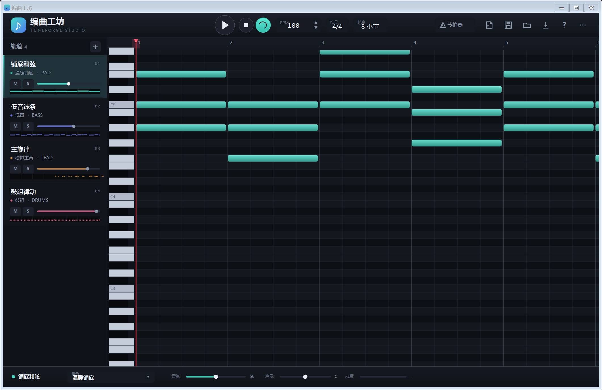
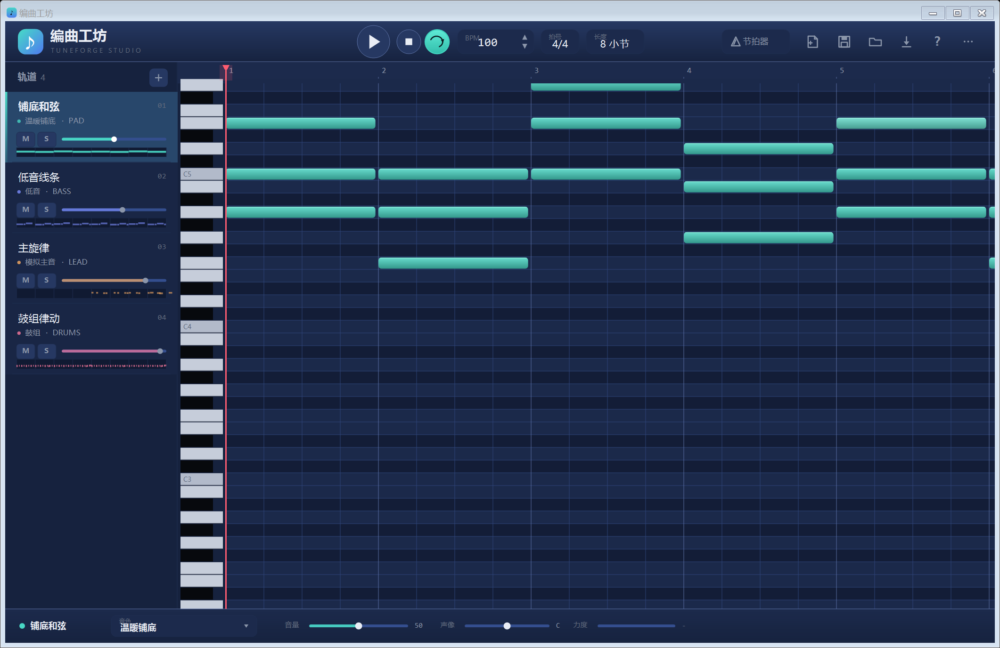
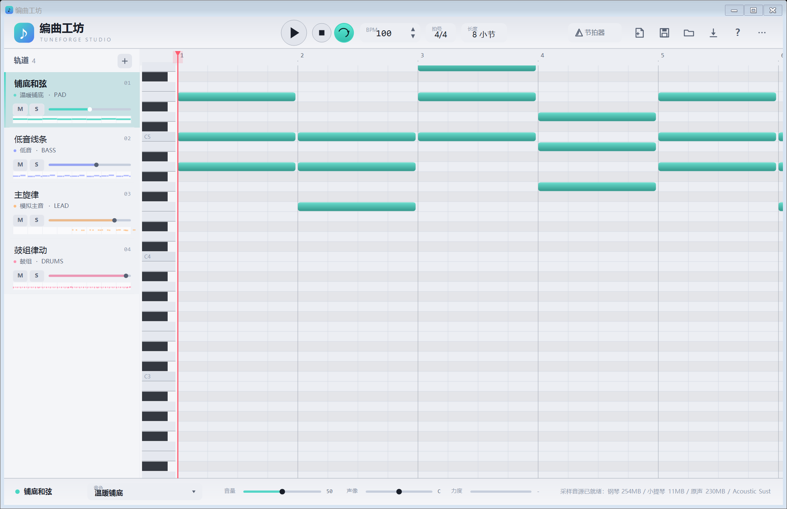
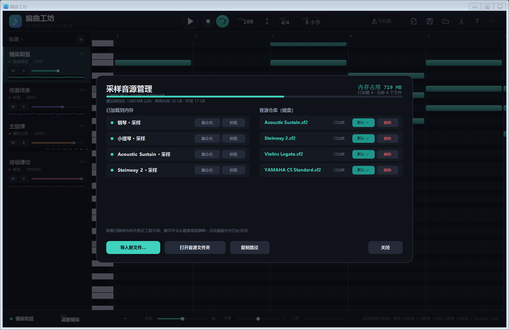

# 编曲工坊 · TuneForge Studio

> 一款轻量级音乐编曲软件 —— 钢琴卷帘 + 多轨合成器 + SF2 采样音源 + WAV 导出。
> 单文件 exe，双击即用，无需安装运行时，无需联网。



---

## 功能一览

| 模块 | 说明 |
| --- | --- |
| **钢琴卷帘** | 8 小节起、可扩展至 128 小节；左键拖空白新建音符、右边缘拖动改长度、拖动移音高/位置、右键双击删除 |
| **多轨编排** | 每轨独立音色 / 音量 / 声像 / 静音 / 独奏；轨道卡片可右键重命名、复制、删除、上移下移、换颜色 |
| **16 + N 音色** | 模拟主音、温暖铺底、拨弦、低音、电钢琴、铃音、管风琴、弦乐、明亮方波、柔和钟琴、普通钢琴、尼龙吉他、小提琴、竖琴、电贝斯、长笛、鼓组；额外加载任意 **SF2 采样音源** |
| **单音级编辑** | 每个音符可单独设力度、单独覆盖音色（不必整轨换音色） |
| **采样音源** | 内置钢琴 / 小提琴 / 原声长音三套 SF2；自动扫描 `音源` 目录下的 `*.sf2`；管理面板支持加载 / 卸载 / 重命名 / 默认加载 / 从磁盘删除 |
| **8 套主题** | 暗夜青、深海蓝、暮光紫、暖琥珀、森林绿（深色）+ 纸白、晨雾蓝、米黄（浅色）；只改背景色，音符颜色保持不变 |
| **播放与导出** | 实时播放（winmm）、节拍器、循环、BPM 40–240、拍号 4/4·3/4·2/4·6/8·5/4·7/8·12/8·9/8；导出 44.1kHz / 16bit / 立体声 WAV |
| **工程文件** | `.tforge`（JSON 明文），默认保存在 exe 同级 `工程` 目录 |

## 快速开始

1. 下载 `TuneForge.exe`，双击运行（**不需要安装 .NET Framework，Win10/11 自带**）。
2. 按 **空格** 播放内置示例曲。
3. 左侧拖音量、点 `+` 加轨道；中间卷帘区左键拖空白处画音符。
4. `Ctrl+S` 保存工程，`Ctrl+E` 导出 WAV。

> 需要采样音源时，把 `*.sf2` 放进 exe 同级的 `音源` 文件夹，重启即可自动识别；也可以从菜单 **⋯ → 导入采样音源** 临时加载。

## 界面





### 采样音源管理



- **左栏「已加载到内存」**：当前占用内存的采样音色，可重命名、卸载
- **右栏「音源仓库（磁盘）」**：`音源` 文件夹里的所有 `*.sf2`，可加载 / 设默认 / 从磁盘删除
- 顶部显示内存占用与系统内存余量，超过 1200 MB 会变红提醒

## 快捷键

| 按键 | 功能 |
| --- | --- |
| `空格` | 播放 / 暂停 |
| `Ctrl+N` / `Ctrl+O` / `Ctrl+S` / `Ctrl+Shift+S` | 新建 / 打开 / 保存 / 另存为 |
| `Ctrl+E` | 导出 WAV |
| `Ctrl+Z` | 撤销（40 步） |
| `Delete` | 删除选中音符 |
| `Ctrl+↑` / `Ctrl+↓` | 选中音符力度 ±1 |
| 滚轮 | 垂直滚动音域 |
| `Shift` + 滚轮 | 水平滚动时间 |
| `Ctrl` + 滚轮 | 缩放时间轴（以鼠标位置为锚点） |
| 滚轮悬停在 BPM / 拍号 / 长度上 | 直接调节 |
| 拖动时间尺 | 移动播放头（实时预览） |
| `F1` | 操作指南 |

## 右键菜单

- **音符**：力度 +1 / -1 / +10 / -10 / 输入数值、长度输入、音色覆盖、删除
- **轨道卡片**：重命名、复制轨道、删除轨道、颜色（8 色）、音色、上移 / 下移
- **⋯ 主菜单**：新建 / 打开 / 保存 / 另存为 / 导出 WAV / 主题 / 导入采样音源 / 采样管理 / 操作指南 / 关于

## 从源码编译

只需要 Windows 自带的 .NET Framework 4.x 编译器（`csc.exe`），**无需 Visual Studio / .NET SDK**：

```powershell
# 在项目根目录执行
powershell -NoProfile -ExecutionPolicy Bypass -File .\build.ps1
# 产物：build\TuneForge.exe
```

`build.ps1` 会调用 `C:\Windows\Microsoft.NET\Framework64\v4.0.30319\csc.exe`，带上 `/codepage:65001 /target:winexe /optimize+` 与 `app.ico`。

## 目录结构

```
TuneForge/
├─ TuneForge.exe          主程序（单文件）
├─ 使用说明.txt           面向普通用户的操作说明
├─ 音质检验报告.txt        音频指标实测报告
├─ app.ico               图标
├─ build.ps1             编译脚本
├─ src/                  C# 源码
│  ├─ Program.cs         入口 + 命令行探针（--shot / --export / --selftest ...）
│  ├─ MainForm.cs        主窗体与全部自绘界面
│  ├─ MainForm.Input.cs  鼠标 / 键盘 / 菜单 / 采样面板交互
│  ├─ Theme.cs           8 套主题与派生色
│  ├─ Model.cs           工程数据模型 + 17 个合成器预设
│  ├─ Synth.cs           振荡器 / ADSR / 滤波器 / Karplus-Strong 拨弦 / 鼓组合成
│  ├─ Renderer.cs        多轨渲染、混响、母带处理
│  ├─ AudioEngine.cs     winmm waveOut 实时播放（独立渲染线程 + 环形缓冲）
│  ├─ Sampler.cs         SF2 采样声部
│  ├─ Sf2.cs             SF2 解析器
│  └─ Json.cs            极简 JSON 读写
├─ tools/                Python 辅助脚本（SF2 探查、音频分析）
├─ 截图/                 界面截图
├─ 工程/                 工程文件默认保存位置
└─ 音源/                 把 *.sf2 放这里即可自动加载（不随仓库分发）
```

## 采样音源说明

仓库**不包含** SF2 文件（体积太大）。需要时自行准备，放进 `音源/`：

| 文件名 | 音色 |
| --- | --- |
| `YAMAHA C5 Standard.sf2` | 钢琴 · 采样 |
| `Violins Legato.sf2` | 小提琴 · 采样 |
| `Acoustic Sustain.sf2` | 原声长音 · 采样 |

其余任何 `*.sf2` 都会被自动扫描并作为新音色加入列表。

## 已知限制

- 仅支持 Windows（WinForms + winmm）。
- SF2 只解析基础层（preset / zone / sample），不处理 modEnv、filter、LFO 等高级 modulator。
- 采样全部读入内存，加载多套大音源会占用较多内存（面板里有占用提示）。
- 混响为简化 Freeverb，不是卷积混响。

## 版本历史

| 版本 | 内容 |
| --- | --- |
| v1.0 | 初版：钢琴卷帘、10 音色、播放、保存、导出 WAV |
| v1.1 | 主菜单（新建/打开/保存/导出/帮助）、按钮提示 |
| v1.2 | 音频引擎重构：独立渲染线程 + 环形缓冲，消除欠载爆音；高通滤波、立体声加宽、DC 阻断 |
| v1.3 | 工程文件夹；新增钢琴/吉他/小提琴/竖琴/电贝斯/长笛；内置《小星星》示例 |
| v1.4 | 去电子感：随机初相位、双弦失谐、起音噪声、亮度包络、音高包络 + 颤音、指数衰减、混响 |
| v1.5 | 非谐泛音（拉伸调律），钢琴改为加法合成 |
| v1.6 | SF2 采样音源接入（钢琴 / 小提琴 / 原声长音） |
| v1.7 | 稳定性（GDI+ 泄漏修复、AntiAliasGridFit）、轨道右键菜单、单音力度与音色、BPM/拍号/长度可调 |
| v1.8 | 底栏力度滑块、音符长度自由调节、轨道颜色自定义、修复底栏音量跳 100% |
| v1.9 | 8 套主题、采样管理面板、自定义 SF2 扫描、Karplus-Strong 物理建模拨弦、浅色主题适配 |

## 许可

MIT License，见 [LICENSE](LICENSE)。
